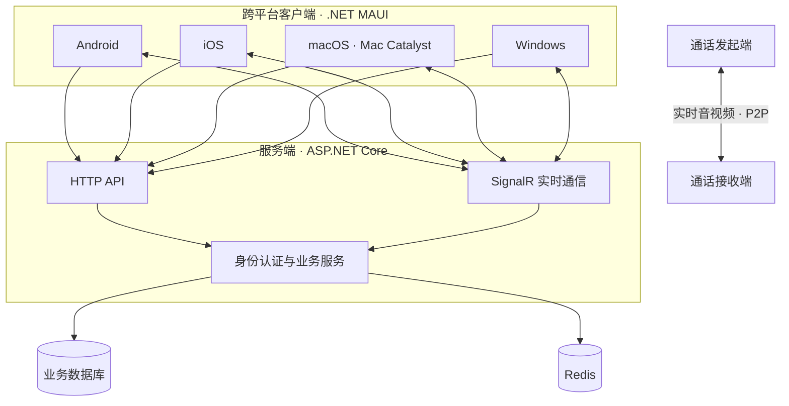

<div align="center">

# Hoyi · HY

### 一个用 .NET 构建的跨平台实时通信项目

以 C# 为核心，使用 .NET MAUI 构建客户端，使用 ASP.NET Core 提供服务，探索从即时消息到实时音视频通信的完整实现。

<p>
  <a href="https://github.com/CH-1024/HY/stargazers"></a>
  <a href="https://github.com/CH-1024/HY/network/members"></a>
  <a href="https://github.com/CH-1024/HY/blob/master/LICENSE.txt"></a>
  
  
</p>

[项目源码](https://github.com/CH-1024/HY) · [提交 Issue](https://github.com/CH-1024/HY/issues) · [参与改进](https://github.com/CH-1024/HY/pulls)

</div>

---

## ✨ 项目简介

**HY（Hoyi）** 是一个持续开发中的跨平台通信应用。客户端采用 **.NET MAUI**，后端采用 **ASP.NET Core**，通过实时通信与音视频技术连接不同设备。

项目不仅包含客户端 UI，也公开了服务端源码，适合体验跨平台应用开发、实时消息推送，以及实时视频通话相关实现。

## 🚀 功能一览

| 功能 | 状态 | 说明 |
|---|:---:|---|
| 👤 账号与登录 | ✅ | 用户注册、登录及账号相关管理 |
| 🤝 好友管理 | ✅ | 搜索、添加好友及联系人管理 |
| 💬 实时聊天 | ✅ | 多端实时消息通信 |
| 📝 文字消息 | ✅ | 发送与接收文本消息 |
| 🖼️ 图片消息 | ✅ | 图片消息及图片预览 |
| 🎬 视频消息 | ✅ | 视频消息及视频预览 |
| 📁 文件管理 | ✅ | 文件相关管理能力 |
| 📹 实时视频通话 | ✅ | 平台原生摄像头采集、VP8 编码与 P2P 实时传输 |
| 🎙️ 实时语音通话 | ✅ | 通过平台原生音频接口采集，统一编码并实时传输 |


> 语音通话与视频通话均已完成开发。音频采集采用平台原生实现，并通过统一的编码与传输流程接入实时通话；实际体验效果仍会受到网络环境、设备性能、系统权限和 NAT 类型等因素影响。

## 📱 跨平台支持

客户端项目当前配置了以下目标框架：

| 平台 | Target Framework |
|---|---|
| Android | `net10.0-android` |
| iOS | `net10.0-ios` |
| macOS（Mac Catalyst） | `net10.0-maccatalyst` |
| Windows | `net10.0-windows10.0.19041.0` |

> Windows 目标框架由 Windows 环境下的项目配置启用。iOS、Mac Catalyst 的真机调试和发布还需要相应的 Apple 开发环境、签名证书及描述文件。

## 🧰 技术栈

<table>
  <tr>
    <td width="160"><strong>客户端</strong></td>
    <td>
      
      
      
      
    </td>
  </tr>
  <tr>
    <td><strong>服务端</strong></td>
    <td>
      
      
      
    </td>
  </tr>
  <tr>
    <td><strong>数据与缓存</strong></td>
    <td>
      
      
    </td>
  </tr>
  <tr>
    <td><strong>实时音视频</strong></td>
    <td>
      
      
      
    </td>
  </tr>
</table>

## 🏗️ 整体架构



- **业务请求**：客户端通过 HTTP API 访问服务端业务能力。
- **实时消息**：通过 SignalR 进行实时通信与事件推送。
- **语音通话**：通过各平台原生音频接口完成采集，再进入统一的音频编码与实时传输流程。
- **视频通话**：使用平台原生摄像头采集，统一采用 VP8 编码，并通过 P2P 进行实时传输。

## 🗂️ 项目结构

```text
HY/
├── HY.MAUI/           # .NET MAUI 跨平台客户端
├── HY.ApiService/     # ASP.NET Core 服务端
├── HY.slnx            # 解决方案文件
├── LICENSE.txt        # MIT License
└── README.md
```

## ⚡ 快速开始

### 1. 环境准备

- [.NET 10 SDK](https://dotnet.microsoft.com/download/dotnet/10.0)
- .NET MAUI 工作负载
- Visual Studio（Windows）或 Rider / Visual Studio Code 等开发工具
- 按需准备 Android SDK、Xcode 和 Apple 签名环境
- 若启动自己的服务端，还需要配置项目所依赖的数据库、Redis 及相关服务参数

安装 MAUI 工作负载：

```bash
dotnet workload install maui
```

### 2. 获取源码并还原依赖

```bash
git clone https://github.com/CH-1024/HY.git
cd HY
dotnet workload restore
dotnet restore HY.slnx
```

### 3. 体验客户端

可以使用 IDE 打开 `HY.slnx`，选择目标平台与设备后运行 `HY.MAUI`。

也可以按开发环境分别构建：

**Android**

```bash
dotnet build HY.MAUI/HY.MAUI.csproj -f net10.0-android
```

**Windows**（请在 Windows 环境执行）

```powershell
dotnet build HY.MAUI/HY.MAUI.csproj -f net10.0-windows10.0.19041.0
```

**macOS（Mac Catalyst）**

```bash
dotnet build HY.MAUI/HY.MAUI.csproj -f net10.0-maccatalyst
```

**iOS**

```bash
dotnet build HY.MAUI/HY.MAUI.csproj -f net10.0-ios
```

iOS 真机部署通常还需要有效的 Apple Developer 账号、签名证书、Provisioning Profile 和设备授权。

### 4. 体验聊天功能

仓库当前说明提供了作者部署的体验服务器。运行客户端后，可自行注册两个测试账号、互相添加好友，再尝试文字、图片、视频消息和视频通话。

> **体验提示：** 公共体验服务的可用性与配置可能变化。请使用测试账号和非敏感内容，不要使用重要账号的密码，也不要发送隐私文件。

### 5. 自行部署服务端

服务端源码位于 `HY.ApiService`。自行部署前，请先检查项目配置文件，并根据实际环境配置数据库连接、Redis、证书密钥、服务监听地址、HTTPS 与客户端访问地址。

> **注意：** 服务端需要FFMPEG完整可访问路径，用来解析上传的视频文件。

```bash
dotnet restore HY.ApiService/HY.ApiService.csproj
dotnet run --project HY.ApiService/HY.ApiService.csproj
```

部署后，还需要将客户端的 API / SignalR 服务地址调整为自己的服务地址，并确认防火墙、反向代理和相关端口配置正确。**不要把数据库密码、JWT 密钥、云服务凭据或其他秘密提交到 Git 仓库。**

## 🛣️ 后续计划

- [ ] 持续优化跨平台 UI 与交互体验
- [ ] 持续优化弱网环境下的消息与音视频稳定性
- [ ] 完善部署文档与项目使用说明

以上为开发方向，实际计划会根据项目进展调整。

## 🤝 参与项目

欢迎通过以下方式参与改进：

- 发现问题或提出功能建议：[提交 Issue](https://github.com/CH-1024/HY/issues)
- 改进代码或文档：[提交 Pull Request](https://github.com/CH-1024/HY/pulls)

提交前请尽量说明复现步骤、运行平台、系统版本和相关日志，便于定位问题。

## 📄 开源许可

本项目基于 [MIT License](https://github.com/CH-1024/HY/blob/master/LICENSE.txt) 发布。使用、修改或分发时，请遵守仓库中的许可证条款。

---

<div align="center">

**如果这个项目对你有帮助，欢迎点亮 ⭐ Star！**

Made with ❤️ and .NET

</div>
